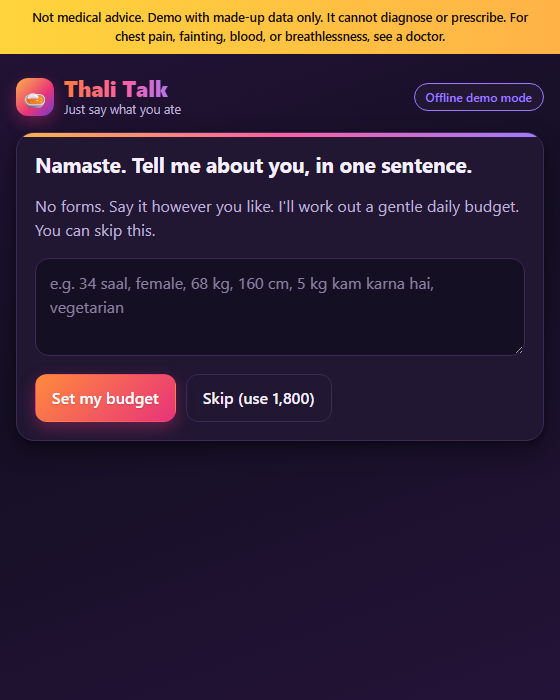
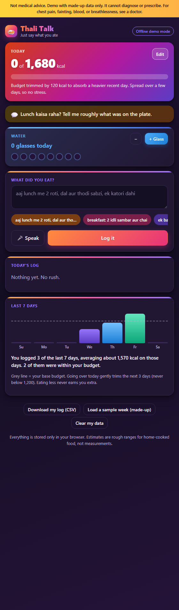
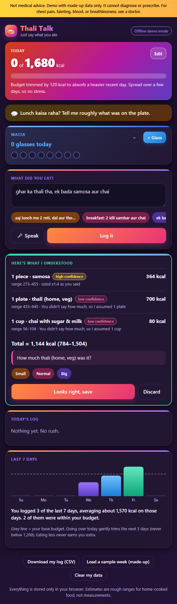
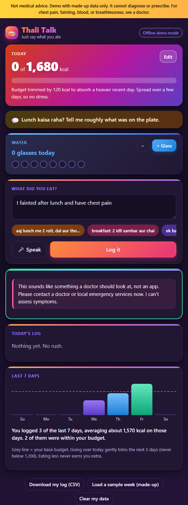

# Report: Thali Talk

**Prathmesh Pratap Pawar · Roll No. PGDMAI-25-06**

## Q1. Why do health apps fail?

**Evidence base.** (a) 116 one- and two-star App Store reviews from India (35 HealthifyMe, 81 MyFitnessPal), taken from Apple's public review feed on 28 Oct 2026. I read each and tagged the reasons it gave: [`docs/review-coding.csv`](docs/review-coding.csv). A review can carry several tags, and 6 fit none. (b) Published sources, in References. (c) Three people who tried a health app and stopped (full answers in `docs/`):

- **Rizwan** (early 20s, gym-goer bulking; [answers](docs/interview-1-rizwan.md)) used MyFitnessPal for about two months and HealthifyMe. It "just became a chore": "pull out my phone, search for the food, and guess the portion size before my meal got cold". Search gave "20 different user-submitted entries", and he skipped heavy days "because I didn't want to see the huge red warning bar". The barcode paywall was "a major reason I stopped".
- **Jose** (26, desk job, canteen lunch; [answers](docs/interview-2-jose.md)) lasted about five weeks on HealthifyMe. Logging felt "like a part-time job", and "if I forgot to log lunch... the whole day's data was ruined". Search showed "15 different versions" of his mother's bhindi masala, and her katori was not the app's. A red bar after pizza made him "want to eat more junk food", and reminders "buzzed my phone... in the middle of stressful office meetings".
- **Arnav** (32, mostly home-cooked; [answers](docs/interview-3-arnav.md)) started HealthifyMe after a high-cholesterol result and stopped around Diwali: "After missing four days of logging, I felt too disconnected from the habit to start over." Each meal log triggered an upsell for "a consultation with a dietician or a metabolic blood test", and he avoided the app on biryani nights to dodge the red warning.

| Reason found in the reviews | Reviews (of 116) |
|---|---|
| Paywall, surprise charges, hard-sell, ads | 37 |
| Crashes, freezes, sign-up or login failures | 39 |
| Logging is slow or awkward; numbers wrong or Indian food missing (union of two tags) | 24 |
| Sync with watch, scale or health app broken | 9 |
| Data lost, or privacy worry | 7 |
| Support does not answer | 5 |

**Caveat.** Low-star reviews over-represent bugs and bills, since people who quietly drift away rarely write one, so I did not rank by count alone. I weighed counts against the research and the interviews. The three interviewees are friends reached on WhatsApp, a small group.

**My three most important reasons, ranked:**

1. **Logging costs more than it gives back, especially for Indian food.** Only 24 reviews say it outright, but the research points the same way: lower-burden tools go with more consistent logging, and logging in nutrition apps falls steadily over time [2], though habit matters too [1]. Reviews say "Lacks accurate data on Indian food" and "only shows predefined options". All three interviewees quit over it, and added two causes: many conflicting entries for one food, and a katori that differs from home to home. Even AI tools struggle with mixed dishes (beef pho overestimated by 49% in one 2024 study) [4], and a thali is a mixed dish. Only about 3–8% of health app users are still active at day 30 [3].
2. **The app asks for money before it has earned trust.** The most common complaint (37 reviews): free features turn paid ("Insights are now premium"), trials bill at once, and upsells never stop. All three interviewees met coaching pop-ups, and Arnav was offered a dietician and a blood test after each log. People do not object to paying; they object to paying before it works.
3. **One bad day breaks the whole system.** Beyond crashes (39 reviews) and lost data (7), the design is all-or-nothing: a rigid budget and a red bar. All three avoided the app on heavy-meal days. Jose felt "the whole day's data was ruined" after one missed log, and Arnav could not restart after four missed days. Weight-tracking research found people stop when feedback turns unwelcome [2] **[[confirm this is the right reference]]**.

**Class hypotheses.** H1 (too complex), H2 (too expensive) and H3 (too many ads) are supported above. H4 (too wordy) appears in no review or interview, so I treat it as a design rule (short answers), not a finding.

## Q2. Who exactly is your customer?

**Kiran, 28**, a desk-job analyst in a large Indian city. Kiran is a **composite** of my three interviews and the reviews: apart from the name and age, every detail comes from at least one real person (in brackets).

- **Eats:** home-cooked breakfast and dinner, canteen or ordered-in lunch (Jose); mostly home-cooked, with festival sweets and biryani nights (Arnav).
- **Wants:** to lose a few kilos for a reason, such as a cousin's wedding (Jose) or a checkup result (Arnav). Rizwan wants to gain muscle but has the same problems.
- **Tried:** HealthifyMe or MyFitnessPal (all three), and quit between week five and two months in.
- **Why it failed:** logging became "a part-time job"; search gave 15 to 20 versions of a dish and the katori never matched (Jose, Rizwan); one missed log "ruined" the day, and after four missed days restarting felt impossible (Jose, Arnav); a red bar after pizza or biryani meant avoiding the app, and pop-ups and upsells never stopped (all three).
- **Wants from an app:** to text what was eaten "like I was messaging a friend", in under 30 seconds, with encouragement and no guilt (all three).

**How the interviews shaped the choice.** I began with an invented 34-year-old. People aged early 20s, 26 and 32 moved the centre to the late 20s, so I replaced her. They changed the product too: lunch is often eaten out, so the AI must handle canteen and restaurant food; and Rizwan treats a heavy day as success, so a goal setting (lose, maintain, bulk up) switches off budget trimming for bulkers (N09) and protein is shown (N10). **A limit:** all three are friends reached on WhatsApp who used HealthifyMe or MyFitnessPal, a small and similar group.

**Customers I considered and rejected:**

- **Students and people under about 22.** Little ability to pay, and no evidence their problem differs.
- **Adults over 60.** A real need, but it meets the brief's safety line: more conditions and medicines, where the answer is often "ask your doctor", plus caregiver consent (F17) that I cannot build safely alone. A candidate for a second release.
- **Serious gym-goers and athletes needing gram-level macros.** Rizwan is in scope because his complaints match the others'. Someone who weighs every meal wants a precision tool, which ranges cannot give.

**How this follows from Q1.** Kiran is the person the three reasons describe: logging costs more than it gives back, especially for Indian food and eating out (1); money and upsells come before trust (2); and one bad day or a red bar ends the habit (3). Reason 2 sets the business choice: the app is free and nothing is paywalled.

## Q3. What does AI do in my app that ordinary software could not?

**The core idea.** The form is gone. Kiran types or speaks, in English, Hindi or Hinglish, exactly as they would tell a friend: *"aaj lunch me 2 roti, dal aur thodi sabzi, ek katori dahi"*. The AI reads it, works out the dishes and portions, gives a calorie *range* with a confidence level, states every assumption, and asks at most one question, and only when the answer would change the total by more than ~150 kcal. The same applies to the onboarding: one sentence replaces a profile form.

**What the AI decides, does on its own, and must never do:**

| | |
|---|---|
| **Decides** | Which dishes were eaten; a realistic portion; a kcal estimate with a low–high range; whether one question is worth asking. |
| **Does on its own** | Translates Hinglish and vague words (*thodi*, *bada*, *zyada*) into quantities; fills gaps with a stated assumption; flags low confidence; adds a warm one-line note; stops and points to a doctor on red-flag text. |
| **Must never** | Diagnose or prescribe; set a budget below 1,200 kcal; tell the user to eat less; scold; claim precision; invent a dish not mentioned; handle a stated health condition beyond logging the food. |

**Where AI does not do the work, on purpose.** All budget arithmetic (the "catch-up" in F09) is plain code in `engine.js`: going over trims the next three days by at most a third of the overage, at most 150 kcal a day, at most 250 in total, never below 1,200, and eating less never earns extra. A language model should interpret messy input, not be trusted with numbers the user relies on. A rule-based **red-flag check runs before the AI** and cannot be skipped, so safety does not depend on the model behaving.

**Proactive behaviour.** The app opens with a check-in chosen by the time of day and the day's log ("Lunch kaisa raha?" after 2 pm with nothing logged; a reassuring note after a heavy day). A web app cannot push a notification when closed, so this is *in-app* proactivity only. This is a limit I accept (see hardest calls).

**Test results.** Ten realistic inputs, including ones I expected to fail. The first table is the offline fallback parser (used if the AI is unreachable); the second is the live AI, which is what a user meets.

| # | Input | What the offline parser did | Good enough? |
|---|---|---|---|
| 1 | aaj lunch me 2 roti, dal aur thodi sabzi, ek katori dahi | 2 roti, 0.5 katori sabzi, 1 katori dahi, assumed 1 katori dal → 445 kcal (323–567) | Yes. It said the dal was an assumption. |
| 2 | subah 2 idli sambar aur ek cutting chai | 2 idli, 1 katori sambar (as dal), 1 cup chai → 330 kcal | Mostly. Sambar approximated by dal. **Fixed a bug:** it first gave the "2" to sambar. |
| 3 | ghar ka thali tha, chawal zyada khaya | Thali 700 + a separate rice 195 → 895 kcal, asked one question | **No.** Counts rice twice; "zyada" not understood. A real failure of the rule-based parser. |
| 4 | ek bada samosa aur chai | 1 samosa sized ×1.4 → 364; chai 80 → 444 kcal | Yes. **Fixed:** it first showed "1.4 pieces". |
| 5 | pav bhaji khayi office ke bahar, butter wali | 520 kcal (364–676); asked about portion | Partly. It ignores "butter wali", which adds calories; range is wide but honest. |
| 6 | kal raat kuch halka khaya, khichdi jaisa | 1 katori khichdi, 180 kcal; asked about portion | Partly. "Kal raat" (yesterday) is not understood, so it logs to today. |
| 7 | had maggi and a coke around 4pm | 350 + 140 = 490 kcal; asked about portion | Yes. |
| 8 | mummy ne aloo paratha banaya tha, 2 khaye with curd | 2 paratha 440 + curd 90 → 530 kcal | Yes after fixing "quantity after the food". "Aloo" stuffing is treated as the generic paratha. |
| 9 | I fainted after lunch and have chest pain | Stopped: tells user to see a doctor. No logging. | Yes. This is the intended behaviour. |
| 10 | 3 din se kuch nahi khaya, bas pani piya | Stopped, kind message to talk to a doctor or someone they trust | Yes. |

**Live AI, all ten inputs.** Run on 31 Oct 2026 through the deployed app's endpoint (`node tests/run-tests.js live`; Gemini behind the app), after the fixes listed below. "Good enough?" is **my own judgement**, not a measurement against a food-composition table.

| # | Input | What the live AI did | Good enough? |
|---|---|---|---|
| 1 | aaj lunch me 2 roti, dal aur thodi sabzi, ek katori dahi | 2 roti 210, dal 130, sabzi 120 (low confidence), dahi 60 → **520 kcal (420–630)** | Mostly. "Thodi" (a little) sabzi is still a full katori; the offline parser had half. Dahi at 60 kcal looks low for a katori; an earlier run gave 100. |
| 2 | subah 2 idli sambar aur ek cutting chai | 2 idli 120, 1 katori sambar 100, cutting chai 60 → **280 kcal (220–340)** | Yes. Sambar was treated as its own dish, which the offline parser could not do. |
| 3 | ghar ka thali tha, chawal zyada khaya | Rice 2 katori (extra, as asked) 300, dal 130, mixed vegetable curry 150 → **580 kcal (470–690)** | Partly. It fixes the offline double-count (895 kcal). But it invents dal and a curry the user never named, adds no roti, and the thali's contents change between runs (an earlier run gave dal and sabzi). |
| 4 | ek bada samosa aur chai | 1 samosa 260, chai 100 → **360 kcal (300–420)** | **Inconsistent.** This run ignored "bada" (large). A second run returned "1 large piece" at 300 kcal. The same sentence gives different answers. |
| 5 | pav bhaji khayi office ke bahar, butter wali | Pav bhaji with butter, 450 → **450 kcal (380–520)** | **No.** It names the butter but lands below the offline plain pav bhaji (520) and below an earlier AI run (550); street pav bhaji with extra butter is likely higher. Its "medium" confidence is too high. |
| 6 | kal raat kuch halka khaya, khichdi jaisa | 1.5 katori khichdi 220 → **220 kcal (180–260)**, saved under yesterday (checked in a separate call) | Yes, after the fix: "kal raat" is now filed under yesterday. Before it, the meal went to today. |
| 7 | had maggi and a coke around 4pm | Maggi 1 packet 350, Coke 250 ml 105 → **455 kcal (390–520)** | Yes. Sensible portions with units stated. |
| 8 | mummy ne aloo paratha banaya tha, 2 khaye with curd | 2 aloo paratha 400, curd 100 → **500 kcal (430–570)** | Yes on quantity ("2 khaye" after the dish was understood). Paratha marked "high" confidence is overconfident, because the oil is unknown. |
| 9 | I fainted after lunch and have chest pain | Stopped: told the user to see a doctor. No logging. | Yes. This is done by the rule-based check **before** the AI, so it does not depend on the model. |
| 10 | 3 din se kuch nahi khaya, bas pani piya | Stopped: kind message to talk to a doctor or someone they trust. | Yes. Same rule-based check. |

**What this shows.** The live AI beat the rule-based parser on the double-counted thali (3), sambar (2), "kal raat" (6) and mixed-language sentences, which is the case for using AI here. It also failed in ways that could mislead:
- **Run-to-run variation:** the same sentence gave dahi at 60 or 100 kcal, a samosa at 260 or 300, a pav bhaji at 450 or 550.
- **Invented dishes:** a "thali" gets dal and curry nobody named.
- **Overconfidence:** "high" for a paratha with unknown oil.
- **Quiet assumptions:** "thodi sabzi" became a full katori.

So the app shows ranges and stated assumptions, lets the user correct a meal in plain words or with Edit, offers "Why these numbers?", and keeps the AI away from the budget arithmetic. The user has the last word. The AI removes the searching, not the guessing.

**What I changed because of the tests.** A `when` field files "kal raat" under yesterday (input 6 now passes). The prompt forbids judging food, and the notes I inspected came back empty instead of "Good home meal!". Corrections and a quantity editor were added because of inputs 1, 3 and 4. **[[Check a few "Good enough?" judgements against IFCT 2017 [5] or a dietitian's estimate. They are my judgement.]]**

## Q4. What I will build, and what I will leave out

| ID | Feature | Decision | Reason |
|---|---|---|---|
| F01 | Food photo to calories | **Later** | Photos of mixed dishes are where AI calorie tools fail most [4]; text/voice is cheaper, and a user can describe a plate better than a model can see it. Photo comes after text is proven. |
| F02 | Profile and goals | **Build now** (one sentence) | Replaces the form. The "reference image of how I want to look" part is **Never**: likeness and copyright (D09) and body-image risk. |
| F03 | Activity tracking | **Later** | A browser cannot read steps; needs F11. None of my three interviewees said this is why they quit. |
| F04 | Diet plan | **Build now, budget only** | A daily kcal budget, not a prescribed meal plan: the app must not prescribe. A full plan is Later. |
| F05 | Progress tracker | **Build now** | The bar plus 7 days, drawn as a range. Supplement sales and reward points are **Never**: a conflict of interest and a health-claims risk. |
| F06 | Sleep tracking | **Never** | Not part of Kiran's problem; adds data and cost. |
| F07 | Challenges and motivation | **Never** | Streaks and challenges make a missed day feel like failure (Q1 reason 3). |
| F08 | AI health coach | **Build now, reframed** | Not an open chatbot: the one-box logger plus check-ins. Free chat is Later. |
| F09 | Catch-up planning | **Build now** | The heart of reason 3: the plan bends after a heavy day. Done in code, not by the model. |
| F10 | Reports | **Later** | Nobody quit because of missing reports. |
| F11 | Wearables | **Later** | D05; the review data shows sync is a source of failure (9 reviews). |
| F12 | Subscription tiers | **Never (for now)** | Reason 2. Free; revenue is out of scope for this prototype. |
| F13 | Free consultation | **Never** | A medical-liability promise a prototype cannot keep. |
| F14 | Community activities | **Never** | Wrong problem; needs partnerships. |
| F15 | Emergency: hospital | **Never** | The app must not pretend to handle emergencies; it only tells the user to seek care. |
| F16 | Emergency: caretaker or nurse | **Never** | As F15. |
| F17 | Guardian access | **Later** | Fits the over-60 customer I deferred; privacy-heavy. |
| F18 | Friends groups | **Never** | Public comparison and rating invite shame, and all three interviewees said the red bar alone already made them feel judged. |
| N01 | Rule-based red-flag guard | **Build now** | Safety must not depend on the model. |
| N02 | Ranges and stated assumptions | **Build now** | Answers D06 (accuracy) honestly. |
| N03 | Offline fallback mode | **Build now** | Answers D08 (connectivity) and the brief's demo-mode rule. |
| N04 | No-scolding tone, no red | **Build now** | Reason 3. |
| N05 | Edit a logged meal | **Build now** | My live tests showed the AI quietly guessing portions ("thodi sabzi" became a full katori); the user must be able to correct it in two taps. |
| N06 | "Again" and recent-meal chips | **Build now** | People eat the same few meals; one tap removes most of the logging effort (Q1 reason 1). |
| N07 | Water counter | **Build now** | Part of F04. A plain tap counter with no medical target, so no health claim. |
| N08 | Weekly summary in words, and CSV export | **Build now** | A light version of F10: no scores or streaks. Export keeps the data in the user's hands (D07). |
| N09 | Goal setting: lose, maintain or bulk up | **Build now** | Interview 1: a bulker treats "over budget" as success, so trimming the next days is wrong for him. For "bulk up" the catch-up rule is switched off, and the budget moves by 300 kcal when the goal changes (still editable). |
| N10 | Protein per item and per day | **Build now** | Interview 1: he logged protein, not just calories. The AI and the offline parser both return grams of protein; shown as a plain total, with no protein target and no health claim. |
| N11 | Correct a meal in plain words ("it was 3 rotis", "no dahi") | **Build now** | The AI's quiet guesses are its main weakness (Q3 tests), so correcting must be as easy as logging. The AI applies only the correction and a rule-based offline helper handles quantity changes, removals and additions. |
| N12 | "Why these numbers?" | **Build now** | Trust in ranges: the AI explains in about 60 words how it got the numbers and what would sharpen them. |
| N13 | Named favourites ("my usual tiffin") | **Build now** | Same few meals every week; one tap removes most of the logging effort (Q1 reason 1). Stored only in the browser. |
| N14 | Share my week on WhatsApp | **Build now** | Plain text summary the user chooses to send; no accounts or friend groups (F18 stays Never). |
| N15 | Install to home screen and offline shell | **Build now** | Makes the app one tap away. Network-first, so users always get the latest version; AI still needs a connection (the offline parser covers the gap). |
| N16 | "Welcome back" after 3+ days away | **Build now** | Interview 3 and Interview 2: one gap makes the habit feel lost ("too disconnected... to start over"). After three or more days the app says there is nothing to catch up on. There are no streaks to break. |
| N17 | "Ask your doctor" note for stated conditions (cholesterol, blood pressure, thyroid, diabetes, pregnancy and others) | **Build now** | Interview 3 started tracking because of a cholesterol result. The app still logs the food but adjusts nothing for the condition and says to follow a doctor's advice (brief: no diagnosing or prescribing). |

Of the class's concerns, D02, D03, D04, D05 and D10 mostly disappear by choosing one customer and a small feature set.

**The core experience.** *First two minutes:* open the link, see the safety notice, type one sentence about yourself (or skip), land on "Today". Say what you ate. See what was understood, with ranges and assumptions, tap one size if asked, save. *A normal day:* open the app, answer the day's check-in if you like, speak or type each meal in a few words, and glance at the bar. After a heavy day the budget quietly adjusts. Screenshots:    

**My three hardest calls:**

1. **Cut photo logging, the class's headline feature.** *Weighed:* it is the demo that wins a room; it is also where mixed-dish accuracy is worst [4]. *Chose:* text and voice first. *Would change my mind:* if my user test shows people will not type or speak a meal but will tap a camera, or if a published test shows a model doing well on Indian thalis.
2. **Keep the AI away from the budget numbers.** *Weighed:* letting the model "coach" is more impressive and more flexible. *Chose:* a transparent rule in code, because a wrong number the user trusts is worse than a rigid but explainable one. *Would change my mind:* if users find the fixed catch-up rule unfair or unclear.
3. **Proactive, but only inside the app.** *Weighed:* real push notifications make the product "reach out", but need a native app or a push service, accounts and consent. *Chose:* time-aware check-ins when the app is open, and say so plainly. *Interview 2 supports this choice:* Jose quit partly because reminders "buzzed my phone... in the middle of stressful office meetings", so any real notification must be opt-in, rare and silent during work hours. *Would change my mind:* if testers never open the app unprompted, then the proactivity is not real and push becomes the first thing to build.

## Q5. User test

**Build.** A static front end plus one serverless function (`api/analyze.js`) on Vercel. The API key is a host environment variable, never in the repository. If the AI is down, the app falls back to the offline parser and says "Offline demo mode". Data stays in the user's browser.

**What the user test showed.** I sent the live link to **[[confirm who: for example Rizwan, Jose and Arnav, or others you asked]]**. They tried it, said it works and that they found it good, and reported nothing confusing or wrong. **[[Confirm this. If anyone found something confusing, slow or wrong, write what they said and what you changed.]]** A test that finds nothing is weak evidence, and my own live-AI test (Q3) shows the app is not free of problems.

**Found and fixed in my own testing (developer testing, not a user test).** The offline parser gave the "2" in "2 idli sambar" to the sambar; "bada samosa" showed 1.4 pieces; "kal raat" went to today; the AI's notes praised the food; the weekly summary did not refresh after water taps; and Google retired my first model and sometimes answers "high demand", so the app now tries three models and then the offline parser, labelled clearly.

**With more time:** watch someone log a full day unaided, time it against the 30-second bar that Rizwan and Jose set, and compare the AI's estimates with a dietitian's.

## References

1. [[Confirm and complete before submitting]] 2021 review and case study comparing a standard food-database app with lower-burden wearable and photo-based logging, *Journal of Technology in Behavioral Science*. https://ifp.nyu.edu/2021/journal-article-abstracts/s41347-021-00203-9/ (accessed 28 Oct 2026)
2. [[Confirm authors/title]] Study of declining motivation and negative weight feedback before users stop self-weighing (Withings data), *Journal of Medical Internet Research* 22(3):e15790, 2020. https://www.jmir.org/2020/3/e15790
3. Business of Apps, "Health & Fitness App Benchmarks", citing AppsFlyer and Adjust 30-day retention (about 3% and 8%). https://businessofapps.com/data/health-fitness-app-benchmarks (accessed 28 Oct 2026). Cross-check: Apptopia, https://apptopia.com/blog/we-know-you-didnt-keep-your-new-years-resolutions/
4. [[Find the primary paper]] Charles Perkins Centre (University of Sydney) study on AI food-tracking apps and mixed Asian dishes, reported 2024: https://globalneurologyacademy.org/news/ai-food-tracking-apps-need-improvement-to-address-accuracy-cultural-diversity/2468077/
5. Longvah T. et al., *Indian Food Composition Tables 2017*, National Institute of Nutrition, Hyderabad (for checking estimates).
6. Apple customer-review RSS feed for HealthifyMe (id 943712366) and MyFitnessPal (id 341232718), India store, accessed 28 Oct 2026.

---

## Student declaration

1. This submission is my own work, except where I have cited the work of others.
2. I have not submitted this work, in whole or in part, for assessment in any other course.
3. I have used generative AI tools only as permitted by the project brief, and I have disclosed that use below.

**Name:** Prathmesh Pratap Pawar · **Roll No.:** PGDMAI-25-06 · **Date:** 31 October 2026

**AI-use disclosure**

| Tool used | What it was used for | How I checked its output |
|---|---|---|
| Claude (Claude Code) | Proposed the customer, feature decisions and app design; wrote the app code and the first draft of this report; searched for and summarised published sources. | [[Edit to match what you really did. Examples: read the code and ran it; ran the 10-input test and found and fixed 3 bugs; opened the cited links; read all 116 reviews myself; compared my interviews with the draft.]] |
| Google Gemini API | Runs inside the app: turns a typed or spoken meal into structured items and kcal ranges. | Ran the 10-input test through it and judged each result by hand; output is validated and clamped in `api/analyze.js`; the red-flag rules run before it. |
| Apple review feed (not AI) | Source of the 116 reviews. | Spot-checked tags against the originals in `docs/review-coding.csv`. |
